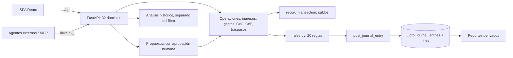
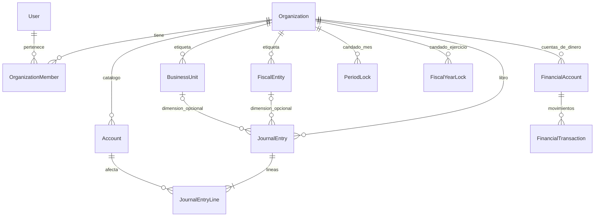
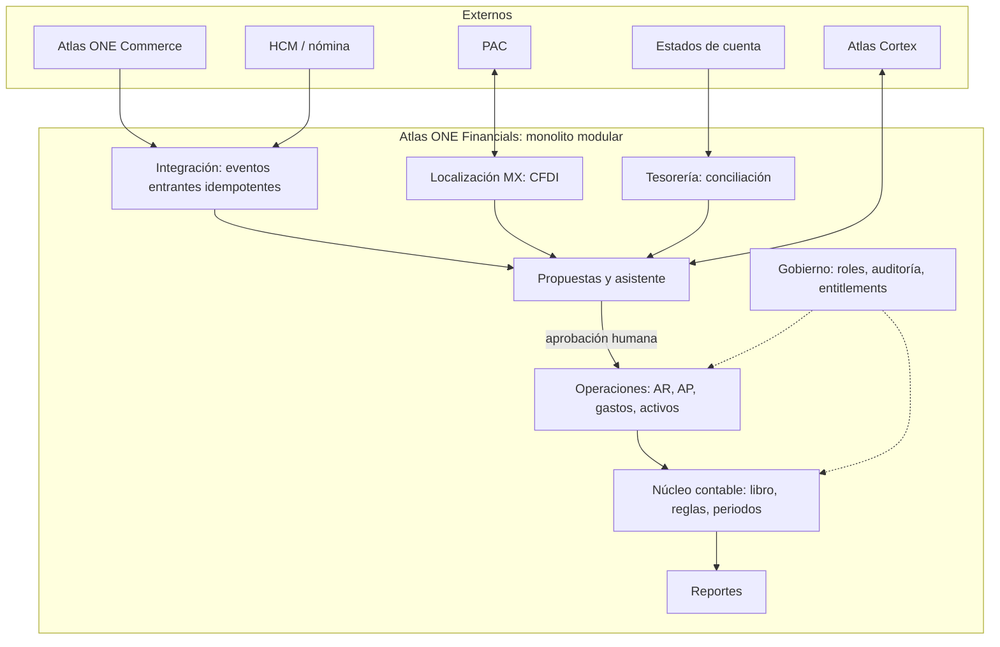

# 03 · Arquitectura y dominio

_Atlas ONE Financials (antes ARCA) · Corte: 2026-11-23 · Fase 0 — Discovery_

## Resumen ejecutivo

La arquitectura actual es un monolito modular correcto para la etapa: un servicio, 32 dominios, un motor contable con un único punto de escritura. La estrategia B no la cambia; le agrega límites de módulo explícitos, una capa de localización mexicana, un contrato de eventos entrantes con idempotencia y, cuando se decida, la entidad legal como dueña de un libro.

La decisión de dominio más cara es **entidad legal y libros**. Hoy organización = tenant = un solo libro, y la entidad fiscal es una etiqueta. Nada de este documento autoriza migraciones.

## AS-IS: mapa de contexto (evidencia)

| Pieza | Dónde vive | Regla que la protege |
|---|---|---|
| Asiento contable | `app/services/accounting/engine.py::post_journal_entry` | Único punto de escritura al libro; exige cuadre y periodo abierto |
| Reglas contables | `app/services/accounting/rules.py` | Una función por evento de negocio |
| Saldos de cuentas de dinero | `app/services/transactions.py::record_transaction` | Único punto que mueve `current_balance` |
| Folios | `app/services/accounting/folios.py` | Inmutables, asignados bajo lock |
| Aislamiento de tenant | `app/security/deps.py::get_current_org_id` | La organización sale de la membresía, nunca del payload |
| Reversos | `app/services/reversals.py` | Póliza espejo; el original queda |
| Bitácora | `app/services/change_log.py` | Append-only, en la misma transacción |

## Modelo de datos actual (evidencia)

Hechos relevantes del modelo:

- `JournalEntry` lleva `folio` único por organización, `source_type` y `source_id` indexados, y `status` (`app/models/accounting.py`).
- `JournalEntryLine` no tiene `organization_id` propio: hereda el tenant de su póliza.
- `debit` y `credit` son `Numeric(14,2)`.
- No hay `CheckConstraint` en la base; el cuadre se garantiza en la aplicación.
- No hay restricción única sobre `(organization_id, source_type, source_id)`.

## Comparación con el modelo conceptual del task pack (§7.1)

| Concepto propuesto | Equivalente actual | Brecha |
|---|---|---|
| Tenant / Organization | `Organization` | Ninguna |
| LegalEntity | `FiscalEntity` | Es etiqueta; no posee libro, catálogo ni periodos |
| Branch | `BusinessUnit` | Es etiqueta |
| Ledger | Implícito: uno por organización | No existe como entidad |
| ChartOfAccounts / Account | `Account` | Un catálogo por organización |
| FiscalPeriod | `PeriodLock`, `FiscalYearLock` | Se modela el candado, no el periodo |
| JournalEntry / JournalLine | `JournalEntry` / `JournalEntryLine` | Ninguna |
| Receivable / Payable | `Receivable` / `Payable` | Ninguna |
| Payment / PaymentAllocation | Pagos dentro del documento y `FinancialTransaction` | No hay aplicación de un pago a varios documentos |
| BankAccount | `FinancialAccount` | Ninguna |
| BankTransaction / Reconciliation | — | Ausente |
| TaxDocument / TaxLine | — | Ausente |
| FixedAsset / DepreciationSchedule | `FixedAsset` | Calendario no modelado como entidad |
| CostCenter / Dimension | `BusinessUnit`, `FiscalEntity`, `Project` | Sin dimensiones configurables |
| AuditEvent | `ChangeLog`, `AgentActionLog` | Ninguna |

## TO-BE: mapa de contexto (propuesta)

Principio: todo lo que llega de fuera entra como **propuesta** o como operación validada por reglas deterministas, y sólo las operaciones escriben al núcleo. Nada externo llama a `post_journal_entry`.

## Límites de módulo y ownership de datos (propuesta)

| Módulo | Es dueño de | Puede leer | No puede |
|---|---|---|---|
| Núcleo contable | Catálogo, pólizas, folios, periodos | — | Depender de ningún otro módulo |
| Operaciones | Ingresos, gastos, CxC, CxP, activos, préstamos | Núcleo | Escribir pólizas fuera de `rules.py` |
| Tesorería | Cuentas de dinero, movimientos, cortes, conciliación | Operaciones | Mover saldos fuera de `record_transaction` |
| Localización MX | Documentos fiscales, validaciones, mapeos SAT | Operaciones, Núcleo | Contener lógica contable |
| Integración | Eventos entrantes, conexiones, reintentos | — | Escribir al libro directamente |
| Inteligencia | Propuestas, conversaciones, uso de IA | Todo, con permisos del usuario | Ejecutar sin aprobación |
| Gobierno | Usuarios, roles, entitlements, bitácora | Todo | — |
| Análisis | Series históricas | Núcleo | Crear pólizas, movimientos o saldos |

## Datos maestros entre suites (propuesta, requiere ADR)

| Dato | Dueño propuesto | Financials guarda |
|---|---|---|
| Cliente comercial | Commerce / CX | Referencia externa + saldo y cartera |
| Proveedor | Financials (hasta que exista SCM) | Registro completo |
| Producto e inventario | Commerce / SCM | Nada; sólo el efecto contable |
| Empleado | HCM | Nada; sólo el asiento de nómina |
| Catálogo de cuentas, pólizas, saldos | Financials | Registro completo |

## Integración: síncrona y asíncrona

| Flujo | Modo propuesto | Razón |
|---|---|---|
| Consultas de Cortex | Síncrono, con llave `ak_` | Ya existe (`domains/agent_api`) |
| Venta confirmada en Commerce | Asíncrono, evento firmado | El origen no debe esperar al libro |
| Nómina autorizada | Asíncrono, evento firmado | Igual |
| Timbrado con PAC | Síncrono con reintento | El usuario espera el resultado |
| Estado de cuenta bancario | Archivo importado (primera versión) | Sin dependencia de agregadores |

**Contrato de eventos entrantes (propuesta):** identificador único del evento en el origen, firma HMAC con ventana de tiempo, referencia externa única por empresa y origen, respuesta distinta para aceptado, duplicado y rechazado. `docs/ARCHITECTURE.md` §8 ya lo describe; **no está implementado**. Se retoma tal cual como diseño.

**Idempotencia:** agregar restricción única en base sobre la referencia externa del evento. Hoy la idempotencia de procesos periódicos descansa en `source_id` sin restricción única.

**Errores:** un evento que falla una regla contable queda guardado con su motivo y se puede reprocesar; nunca se pierde ni se asienta a medias. Reconciliación periódica contra el origen por rango de fechas.

**Salida:** sustituir el bus síncrono (`app/core/events.py`) por outbox durable cuando exista el primer consumidor externo real. No antes.

## Invariantes: estado contra el task pack (§7.2)

| Invariante | Estado | Evidencia o brecha |
|---|---|---|
| Póliza balanceada | Cumplida en aplicación | `post_journal_entry`; sin `CheckConstraint` en BD |
| Decimal, nunca float | Cumplida | ADR-004, `Numeric(14,2)` |
| Contabilización atómica y concurrencia | Cumplida | `lock_organization` con `with_for_update`; `tests/test_bloqueo_postgres.py` |
| Registros inmutables, corrección por reverso | Cumplida | `app/services/reversals.py`, `tests/test_reversos.py` |
| Periodos cerrados protegidos | Cumplida | Candado dentro del motor; reapertura con motivo |
| Idempotencia | Parcial | Sin restricción única en BD |
| Trazabilidad origen → asiento → reporte | Cumplida | `source_type` / `source_id`; `tests/test_movimientos_origen.py` |
| Reportes reproducibles a fecha de corte | Cumplida | Derivados del libro en cada consulta |
| Aislamiento por tenant | Cumplida | `tests/test_tenant_isolation.py` |
| Saldos sin modificación manual | Cumplida | `record_transaction` |
| Política explícita de redondeo | Parcial | `_quantize` en el motor; sin documento de política |

## Estrategia de pruebas

| Tipo | Hoy | Agregar |
|---|---|---|
| Partida doble | `test_ledger.py`, `test_polizas_manuales.py` | Prueba de propiedad: cualquier secuencia de operaciones deja la balanza cuadrada |
| Tenant | `test_tenant_isolation.py` (5 pruebas) | Barrido automático: cada endpoint con recurso de otra organización responde 404 |
| Concurrencia | `test_bloqueo_postgres.py` | Dos pagos simultáneos al mismo documento |
| Idempotencia | Recurrentes, depreciación, importación | Mismo evento entrante dos veces |
| Conciliación auxiliar–mayor | Parcial en `test_reports.py` | Suma de CxC y CxP abiertas igual al saldo de sus cuentas de control |
| Migraciones | Un solo head en CI | Upgrade sobre copia anonimizada de producción |

## Decisiones pendientes

1. Entidad legal y libros (ADR-007 en `08_ARCHITECTURE_DECISIONS.md`).
2. Dueño de datos maestros entre suites (ADR-010).
3. Si se agrega la restricción de cuadre en base de datos además de la aplicación.
4. Momento de introducir el outbox.

## Riesgos

- Cambiar el modelo de tenant con un cliente en producción.
- Que la capa de localización termine con lógica contable y rompa el invariante 9 de `AGENTS.md`.
- Que una integración escriba al libro saltándose las propuestas.
