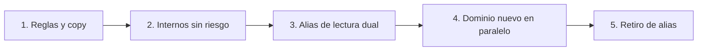

# 04 · Plan de rebranding seguro

_Atlas ONE Financials (antes ARCA) · Corte: 2026-11-23, commit `46f5285` · Fase 1 — Rebranding_

## Resumen ejecutivo

El rebranding ya empezó: el repositorio y el proyecto de Railway llevan el nombre nuevo y la interfaz no muestra "ARCA" al usuario. Quedan tres grupos de trabajo: cambiar el copy visible de "ONE Finance" a "Atlas ONE Financials", limpiar nombres internos sin riesgo, y tratar con alias los cinco puntos donde un cambio directo rompe sesiones, agentes conectados o monitoreo.

Regla del plan: **ningún identificador que alguien externo ya use se renombra sin alias de lectura dual y sin plan de reversa**.

## Estado actual (evidencia)

| Elemento | Estado |
|---|---|
| Repositorio GitHub | `Ecamposg95/Atlas-ONE-Financials` (renombrado; el task pack proponía `atlas-one-financials` en minúsculas) |
| Proyecto Railway | "Atlas ONE Financials" |
| Servicio Railway | `Atlas-ONE-Financials` (renombrado el 2026-11-23; antes `ARCA`) |
| Dominio | `atlas-one-financials.up.railway.app` (cambiado el 2026-11-23; el anterior `arca-production-d769…` responde 404, sin redirección) |
| Auto-deploy desde el repo renombrado | Verificado el 2026-11-23 |
| Copy visible | "ONE Finance" / "Atlas ONE Finance" (`frontend/index.html`, páginas de registro, propuestas, portafolio) |
| "ARCA" visible al usuario | No se encontró en el copy de `frontend/src` |
| Reglas para agentes | `CLAUDE.md` y `AGENTS.md` ordenan escribir "ONE Finance" |

## Inventario de referencias

### Visibles para el usuario

| Referencia | Ubicación | Acción |
|---|---|---|
| Título "Atlas ONE Finance — Administración financiera y contable" | `frontend/index.html` | Cambiar a Atlas ONE Financials |
| "ONE Finance" en copy | `RegisterPage.tsx`, `ProposalsPage.tsx`, `RecurringPanel.tsx`, `PortfolioPage.tsx`, `SalesByMonthChart.tsx`, `ContpaqiExport.tsx` | Cambiar; usar "Atlas Financials" donde el espacio sea corto |
| Logotipo | `frontend/src/components/ui/ArcaMark.tsx` | Renombrar componente; revisar el trazo con la marca |
| Dominio público | Railway | Ver "Cambios con ruptura" |
| Guiones de demo | `docs/demo-contador-guion.md`, `docs/demo-foro-guion.md` | Actualizar antes de la siguiente demo |

### Internas, sin riesgo

| Referencia | Ubicación |
|---|---|
| Loggers `arca`, `arca.events`, `arca.accounting`, `arca.assistant`, `arca.auth` | `app/main.py`, `app/core/events.py`, `app/services/accounting/engine.py`, `app/services/ai/runtime.py`, `app/domains/auth/service.py` |
| Paquete `arca-web` | `frontend/package.json`, `package-lock.json` |
| Clases y animación `arca-rise` | `frontend/src/index.css`, `AuthShell.tsx` |
| Base de desarrollo `arca_dev.db` y secreto de desarrollo | `app/config.py` |
| Usuario y base de CI `arca` / `arca_test` | `.github/workflows/ci.yml` |
| Ejemplo de entorno | `.env.example` |
| Comentarios y docstrings | Varios en `app/`, `scripts/`, `tests/` |
| Partial de IaC `ARCA` | `.railway/railway.ts` (ver nota) |

Nota sobre los loggers: si alguien filtra logs por `arca.*`, el cambio debe avisarse. No hay evidencia de alertas configuradas sobre esos nombres.

Nota sobre el partial: es el nombre con el que Railway registra qué repositorio es dueño del servicio. Tras el renombre, el partial `ARCA` sigue registrado como dueño de la dirección `service.ARCA`, que ya no existe; `railway config plan` no reporta diferencias con el archivo actual. Falta transferir o liberar esa propiedad (`railway config partials`), que sólo cambia metadatos.

### Cambios con ruptura (requieren alias)

| Referencia | Ubicación | Qué se rompe si se cambia sin más | Estrategia |
|---|---|---|---|
| Llave `arca-auth` en `localStorage` | `frontend/src/stores/authStore.ts` | Todos los usuarios pierden la sesión | Leer la llave nueva y, si no existe, migrar la vieja una vez; retirar la lectura dual después de un periodo acordado |
| Llave `arca-theme` | `frontend/src/stores/themeStore.ts` | Se pierde la preferencia de tema | Igual |
| Variables `ARCA_URL`, `ARCA_API_KEY` y servidor MCP `arca` | `tools/arca_mcp.py`, `scripts/demo_forum.py` | Agentes ya configurados dejan de conectar | Aceptar ambos nombres de variable; publicar el nombre nuevo del servidor y mantener el archivo viejo como envoltorio |
| `"service": "arca"` | `app/main.py` (`/api/health`), `tests/test_health.py` | Monitoreo externo que compare el valor | Confirmar si alguien lo consume; si no, cambiar junto con la prueba |
| ~~Nombre del servicio `ARCA` en Railway~~ | Railway, `.railway/railway.ts` | — | Hecho el 2026-11-23: el servicio se llama `Atlas-ONE-Financials`; la red privada conserva el nombre `arca` |
| ~~Dominio `arca-production-d769…`~~ | Railway; scripts, `CLAUDE.md`, `docs/` | Marcadores de usuarios, agentes MCP y sesiones (`localStorage` es por dominio) | Hecho el 2026-11-23 sin periodo de convivencia: el dominio viejo dejó de responder. Queda avisar a los usuarios y actualizar `ARCA_URL` en los agentes configurados |

### No se tocan

- Nombre de la base de datos de producción.
- Nombres de tablas y columnas.
- Identificadores de migraciones de Alembic ya aplicadas.
- Documentos históricos en `docs/superpowers/` (planes y specs fechados): son registro de lo que se decidió entonces.

## Secuencia propuesta

| Paso | Contenido | Gate | Reversa |
|---|---|---|---|
| 1 | Actualizar `CLAUDE.md` y `AGENTS.md` (nombre visible), título, copy, componente del logotipo | Typecheck, build y revisión visual de las pantallas tocadas | Revertir el commit |
| 2 | Loggers, paquete, CI, `.env.example`, comentarios | `pytest`, `ruff`, CI en verde | Revertir el commit |
| 3 | Lectura dual de `localStorage`, variables del MCP, valor de health | Prueba manual: una sesión abierta antes del deploy sigue abierta después | Revertir el commit; la llave vieja no se borra hasta el paso 5 |
| 4 | Alta de `financials.atlastech.mx` junto al dominio actual; CORS para ambos | Login y healthcheck por los dos dominios | Quitar el dominio nuevo |
| 5 | Retirar lectura dual y redirigir el dominio viejo | Sin tráfico relevante en el dominio viejo | Restaurar el alias |

Los pasos 1 a 3 no tocan esquema ni infraestructura. Los pasos 4 y 5 **requieren aprobación explícita**.

## Criterios verificables

- Cero apariciones de "ONE Finance" en `frontend/src` y `frontend/index.html` al terminar el paso 1.
- Una sesión iniciada antes del paso 3 sigue autenticada después del deploy.
- Un agente configurado con `ARCA_URL` / `ARCA_API_KEY` sigue conectando después del paso 3.
- `GET /api/health` responde 200 en ambos dominios durante el paso 4.
- La suite completa pasa en cada paso.

## Decisiones pendientes

1. Subdominio definitivo y quién administra el DNS de `atlastech.mx`.
2. Cuánto tiempo se mantiene la lectura dual y el dominio viejo.
3. Si el logotipo actual se conserva o se sustituye por uno del sistema Atlas ONE.
4. ~~Si se renombra el servicio de Railway~~: renombrado el 2026-11-23.

## Riesgos

| Riesgo | Mitigación |
|---|---|
| Cerrar la sesión de La Fe a media operación | Lectura dual antes de cualquier cambio de llave |
| Romper agentes conectados por MCP | Alias de variables y aviso previo |
| Buscar y reemplazar "arca" a ciegas | La cadena aparece dentro de otras palabras ("marca", "embarcaciones" en `sat_codes.json`); revisar cada coincidencia |
| Reescribir documentos históricos | Se dejan intactos por decisión |
