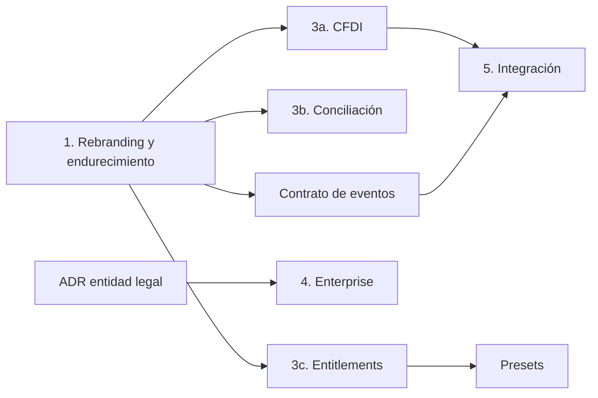

# 06 · Roadmap y backlog

_Atlas ONE Financials (antes ARCA) · Corte: 2026-11-23 · Fase 0 — Discovery_

## Resumen ejecutivo

El roadmap del task pack supone que el núcleo financiero está por construirse. La auditoría muestra que ya existe, así que las fases se reordenan: primero endurecer y renombrar lo que hay, después cerrar las brechas fiscal y de tesorería, y sólo entonces abordar empresa e integración.

Las fases no son fechas ni compromisos. Las estimaciones son relativas (S, M, L, XL) y deben recalibrarse al iniciar cada épica.

## Roadmap ajustado

| Fase | Resultado | Estado | Gate |
|---|---|---|---|
| 0 — Discovery | Auditoría, estrategia y decisiones | Esta entrega | Revisión del founder |
| 1 — Rebranding y endurecimiento | Identidad nueva con compatibilidad; controles de seguridad básicos | Por iniciar | Regresión completa y reversa probada |
| 2 — Financial Core | Mayor, pólizas, periodos, AR/AP, reportes | **Ya implementado** | Mantener invariantes; agregar pruebas de propiedad |
| 3 — Business | CFDI, conciliación bancaria, entitlements y presets | Por iniciar | Validación fiscal con contador; conciliación cuadrada |
| 4 — Enterprise | Entidad legal con libro, dimensiones, segregación de funciones | Requiere ADR | Seguridad y cierre reproducible |
| 5 — Integración e inteligencia | Eventos de Commerce y HCM; Cortex con más autonomía supervisada | Parcial (asistente y agentes existen) | Evaluación de calidad de propuestas |

## Quick wins

No tocan el libro ni el esquema.

| Quick win | Tamaño | Valor |
|---|---|---|
| Rate limiting y lockout en `/auth` y en la invocación por llave de agente | S | Cierra la deuda de seguridad más expuesta |
| Poner `ANTHROPIC_API_KEY` en Railway | S | Activa el asistente en producción |
| Activar la marca de La Fe en producción | S | Pendiente operativo |
| Alias `/api/v1` sobre las rutas actuales | S | Prepara el versionado sin romper clientes |
| Corregir `docs/ARCHITECTURE.md` (separar hoy de plan) | S | Evita promesas falsas a partners |
| Prueba de restauración de respaldo documentada | S | Convierte un riesgo no verificable en un control |
| Code-splitting del bundle (713 KB) | S | Tiempo de carga |
| Rebranding de copy e internos (pasos 1 y 2 de `04_REBRANDING_PLAN.md`) | S–M | Identidad consistente |

## Backlog por categoría

### Producto

**E-01 · Importación de CFDI** (L)

- *Historia:* como contador, subo los XML de mis comprobantes y el sistema me propone el gasto o ingreso correspondiente, para no capturar dos veces.
- *Criterios de aceptación:*
  - Un XML válido se guarda con su UUID, emisor, receptor, conceptos e impuestos.
  - El mismo UUID subido dos veces se marca como duplicado y no crea nada.
  - Cada comprobante genera una propuesta; nada se asienta sin aprobación.
  - Un comprobante ligado a un gasto permite navegar en ambos sentidos.
  - Un XML mal formado o cuyo receptor no coincide con la empresa se rechaza con mensaje en español.
- *Dependencias:* adjuntos (existe), propuestas (existe), investigación de la especificación vigente.
- *Riesgo:* afirmar validación fiscal que no se hace. La primera versión lee y estructura; no valida vigencia ante el SAT.

**E-02 · Conciliación bancaria** (L) — primera versión hecha el 2026-11-24 (`docs/MVP_STATUS.md`); falta crear la operación faltante como propuesta desde el renglón

- *Historia:* como responsable de tesorería, importo mi estado de cuenta y ligo cada renglón con un movimiento, para saber que el saldo en libros es real.
- *Criterios de aceptación:*
  - Un estado de cuenta en Excel o CSV se importa con vista previa.
  - El sistema sugiere coincidencias por monto y fecha; el usuario confirma.
  - Un renglón sin coincidencia permite crear la operación como propuesta.
  - Una conciliación cerrada muestra saldo en banco, saldo en libros y partidas en tránsito, y es reproducible.
  - Conciliar no cambia ningún saldo por sí mismo.
- *Dependencias:* importación tabular (existe en `app/services/imports/tabular.py`).

**E-03 · Entitlements y presets** (M)

- *Historia:* como Atlas Tech, habilito módulos por organización según su plan, para vender la suite por partes.
- *Criterios de aceptación:*
  - Un módulo deshabilitado responde 403 en el backend, no sólo se oculta.
  - `/api/me` informa los módulos habilitados y la interfaz arma la navegación con ello.
  - Aplicar un preset no modifica datos transaccionales.
  - Los entitlements no sustituyen a `require_role`: ambos se evalúan.

**E-04 · Aplicación de pagos** (M)

- *Historia:* como cobrador, aplico un solo depósito a varias facturas.
- *Criterios de aceptación:* la suma aplicada es igual al pago; cada documento refleja su parte; el reverso deshace todas las aplicaciones.

**E-05 · Historial de cambios faltante** (S): categorías, traspasos y contactos (pendiente en `docs/MVP_STATUS.md`).

**E-06 · Viáticos y reembolsos** (M): posponer hasta que un cliente lo pida.

### Deuda técnica

| Ítem | Tamaño | Origen |
|---|---|---|
| ~~Restricción única de idempotencia sobre origen de pólizas~~ | — | Descartada en el sprint 1: el origen se repite por diseño; la restricción va en la tabla de eventos entrantes (ADR-011) |
| ~~Prueba de propiedad de balanza cuadrada~~ | — | Hecha en el sprint 1 (`tests/test_propiedad_balanza.py`) |
| Barrido automático de aislamiento de tenant por endpoint | M | Estrategia de pruebas |
| Expiración y edición de propuestas de agente | S | `docs/MVP_STATUS.md` |
| `cash_flow.opening_cash` cuenta saldos iniciales de cuentas creadas en el periodo | S | `docs/MVP_STATUS.md` |
| Mover adjuntos de PostgreSQL a almacenamiento de objetos | M | `app/services/attachments.py` ya lo aísla |
| Usar el tipo `PROCESSOR` en la importación de Toronja | S | `docs/MVP_STATUS.md` |
| Préstamos y activos con saldo al corte distinto del original | M | `docs/MVP_STATUS.md` |

### Cumplimiento

| Ítem | Tamaño | Nota |
|---|---|---|
| Investigación de requisitos vigentes (CFDI 4.0, complementos de pago, contabilidad electrónica) contra documentación oficial | M | Requisito previo de E-01; no hecha en esta fase |
| Revisión por contador de reglas de IVA, retenciones y deducibilidad existentes | M | Antes de cualquier copy de cumplimiento |
| Política de retención y borrado de datos | S | Ver `07_SECURITY_AND_COMPLIANCE.md` |
| Timbrado mediante PAC | XL | Posponer; requiere manejo seguro de certificados |

### Experiencia de usuario

| Ítem | Tamaño |
|---|---|
| Navegación por módulo (`05_UI_UX_STRATEGY.md`) | M |
| Asistente en contexto | M |
| Lenguaje visual del Inicio en el resto de pantallas | M |
| Lista de verificación previa al cierre de mes | S |

### Interoperabilidad

| Ítem | Tamaño | Nota |
|---|---|---|
| Contrato de eventos entrantes con firma e idempotencia | L | Diseño ya escrito en `docs/ARCHITECTURE.md` §8; sin implementar |
| Outbox durable | M | Sólo cuando exista un consumidor externo |
| Primer flujo Commerce → Financials (venta confirmada) | L | Requiere trabajo en ambos repositorios |
| Renombrar y versionar el servidor MCP | S | Con alias (`04_REBRANDING_PLAN.md`) |

## Priorización

| Orden | Ítem | Por qué ahí |
|---|---|---|
| 1 | Quick wins de seguridad y operación | Riesgo expuesto, costo bajo |
| 2 | Rebranding pasos 1–3 | Decisión ya tomada; desbloquea material comercial |
| 3 | ADR de entidad legal | No se construye, pero condiciona el diseño de CFDI y conciliación |
| 4 | E-01 CFDI | Mayor valor para el mercado mexicano |
| 5 | E-02 Conciliación | Completa tesorería |
| 6 | E-03 Entitlements y presets | Habilita planes comerciales |
| 7 | Contrato de eventos | Cuando Commerce esté listo para emitir |
| 8 | Fase 4 Enterprise | Con un cliente que lo requiera |

## Primer sprint

**Alcance:**

1. Rate limiting y lockout en `/auth`.
2. Rebranding pasos 1 y 2 (copy, reglas para agentes, internos).
3. Corrección de `docs/ARCHITECTURE.md`.
4. ADR-006 (nomenclatura) aceptado y ADR-007 (entidad legal) redactado para decisión.
5. Prueba de propiedad de balanza. (La restricción única de idempotencia se descartó al revisar el código: ver deuda técnica.)

**Definition of Done:**

- `pytest`, `ruff check .`, `npm run typecheck` y `npm run build` en verde.
- CI en verde sobre PostgreSQL.
- Ningún cambio de esquema fuera de las dos columnas del bloqueo de cuenta (`20261123_01`), con su reversa.
- El deploy pasa el healthcheck y una sesión previa sigue activa.
- `docs/MVP_STATUS.md` actualizado.
- Cada afirmación nueva en documentación cita un archivo o se marca como propuesta.

## Riesgos del roadmap

| Riesgo | Efecto | Mitigación |
|---|---|---|
| Iniciar CFDI sin la investigación normativa | Rehacer el modelo | La investigación es requisito de entrada |
| Decidir tarde la entidad legal | CFDI y conciliación nacen atados a la organización | Redactar el ADR en el primer sprint |
| Atender peticiones de un solo cliente como si fueran producto | Suite a la medida | Cada ítem debe ser expresable como capacidad configurable |
| Abrir Enterprise sin cliente | Costo sin validación | Gate comercial explícito |

## Decisiones pendientes

1. ¿El primer sprint queda como está propuesto?
2. ¿CFDI antes que conciliación, o al revés?
3. ¿Quién es el contador que valida las reglas fiscales?
