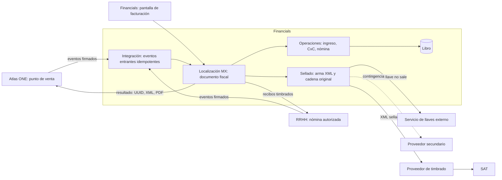

# 09 · Megaplan: timbrado de CFDI y conexión con Atlas ONE y RRHH

_Atlas ONE Financials · 2026-11-24 · Decisiones D1, D2, D3 y D7 aceptadas por el founder el 2026-11-25; D4, D5 y D6 siguen abiertas. Nada de este documento está construido: la aceptación autoriza la fase 0, no el código de timbrado._

Investigación de respaldo: `reports/Timbrado CFDI y conexión Atlas.md` y las notas por tema en `research_notes/Timbrado CFDI y conexión Atlas/` (carpetas locales, fuera de git). Este plan no es asesoría fiscal ni legal: los puntos marcados **[contador]** o **[abogado]** necesitan esa revisión antes de construirse.

## Resumen ejecutivo

Financials será el único lugar del ecosistema que sella, timbra, cancela y conserva CFDI. Atlas ONE (punto de venta) y el producto de RRHH le piden documentos por un contrato de eventos firmados; ninguno de los dos toca certificados ni habla con el SAT.

Cuatro hechos condicionan el plan:

1. **Ningún repositorio tiene hoy código de CFDI, timbrado ni certificados.** Se construye desde cero.
2. **El SAT revocó ocho proveedores de timbrado en 2026**, entre ellos SW sapien y el de CONTPAQi (fuentes secundarias; la lista oficial no se pudo abrir). El diseño debe permitir cambiar de proveedor sin migrar llaves ni reescribir el módulo.
3. **Atlas ONE no calcula IVA en las ventas que no piden factura** y sus productos no tienen claves del SAT. Sin corregir eso no hay factura global ni factura por ticket.
4. **RRHH (HRFlow) no calcula nómina fiscal.** La auditoría del 25-11-2026 sobre `hrflow-next` encontró que paga días por salario diario, sin ISR por tarifa, cuotas reales del IMSS, subsidio, conceptos con clave del SAT ni corrida de nómina, y que no tiene ninguna integración saliente. La fase de nómina exige antes un trabajo grande en ese repositorio (ver fase 6).

La recomendación es sellar en nuestro lado, con la llave del cliente dentro de un servicio de llaves externo, y enviar al proveedor el XML ya sellado sólo para timbrar. El orden propuesto: cimientos fiscales y seguridad, factura individual, conexión con el punto de venta, factura global, pagos y egresos, y nómina al final.

## Decisiones que necesita el founder

| # | Decisión | Recomendación | Por qué |
|---|---|---|---|
| D1 | ¿Quién custodia la llave del certificado de sello digital? | Nosotros, con un servicio de llaves externo (AWS KMS o Google Cloud KMS). Primera opción: la llave firma dentro del servicio y nunca sale. Si la prueba de la fase 1 falla, respaldo: llave cifrada por empresa con la llave maestra en ese servicio, descifrada sólo en memoria al sellar | Cambiar de proveedor no obliga a mover llaves; los revendedores que exigen subir el certificado no documentan cómo lo guardan. Firmar dentro del servicio está documentado pero nadie lo ha probado con un certificado del SAT |
| D2 | ¿Proveedor de timbrado? | Uno autorizado que acepte XML ya sellado, más un segundo de contingencia. Candidatos a cotizar: Prodigia como primario (acepta XML sellado y tiene conector en `satcfdi`); Formas Digitales como contingencia y Solución Factible de reserva; SIFEI descartado porque su cancelación exige el certificado (cotejo del 25-11-2026) | Ocho revocaciones en un año; Facturapi y Facturama son revendedores y exigen el certificado |
| D3 | ¿CFDI antes que la importación de CFDI recibidos (E-01)? | Emitir primero | Es lo que piden el punto de venta y nómina; la importación reutiliza después el mismo modelo de documento |
| D4 | ¿Se integra también el punto de venta anterior (`Atlas-Rmazh`)? | No; esperar a que sus tiendas terminen de mudarse a Atlas ONE | Tiene el mismo modelo pero sin cola durable de eventos; sería trabajo doble |
| D5 | ¿Cómo se resuelve la factura de un ticket que ya entró en una global? | Emitir egreso contra la global y luego la factura nominativa **[contador]** | Las guías del SAT se contradicen; este camino no obliga a cancelar y reexpedir la global completa |
| D6 | ¿Quién revisa lo legal? | Contratar revisión del contrato de custodia y del aviso de privacidad **[abogado]** | La ley no trae formato para que un tercero custodie el certificado; rige la ley de datos personales de 2025 |
| D7 | ¿Dónde está el repositorio de HRFlow? | Clonarlo en `~/Dev` para auditarlo | Sin él no se puede dimensionar la fase de nómina |

**Estado al 2026-11-25.** Aceptadas como se recomiendan: D1 (custodia propia en un servicio de llaves externo), D2 (Prodigia como primario a cotizar y un segundo de contingencia, sujeto a cotejar la lista oficial del SAT), D3 (emitir antes que importar) y D7 (clonar y auditar HRFlow). También se aceptó partir la fase 6 en 6A, 6B y 6C. Abiertas: D4, D5 **[contador]** y D6 **[abogado]**.

## Qué dice la investigación

### Verificado en fuente primaria

- **Sigue vigente CFDI 4.0**, con complemento de pagos 2.0 y nómina 1.2. No hay versión sucesora anunciada (Código Fiscal reformado el 09-04-2026; Resolución Miscelánea 2026).
- **Sello:** SHA-256 con RSA de 2048 bits sobre la cadena original, con el certificado de sello digital. La e.firma no sirve para timbrar con un proveedor y nunca debe pedirse al cliente.
- **Ventana de 72 horas** entre generar y timbrar, con la hora del código postal del lugar de expedición.
- **Receptor:** RFC, nombre, código postal y régimen se validan contra el padrón del SAT, con corte al día anterior.
- **Cancelación:** hasta el mes de la declaración anual del ejercicio; el receptor tiene tres días para responder; hay doce supuestos sin aceptación; sustituir exige timbrar antes el comprobante nuevo.
- **Conservación:** el proveedor guarda los CFDI tres meses; el XML se conserva cinco años por cuenta propia.
- **Factura global:** regla 2.7.1.21, sin cambios en 2026. Diaria, semanal o mensual; un concepto por ticket; el código postal de la sucursal apunta a una global por sucursal; siempre pago en una exhibición.
- **Complemento de pagos:** sólo para facturas nominativas en parcialidades o diferido; se emite a más tardar el día 5 del mes siguiente. Las ventas a crédito al público en general no lo llevan.
- **Nómina:** un CFDI por empleado, un concepto, sin impuestos; la forma de pago no debe aparecer; se cancela sin aceptación del empleado. El registro patronal decide qué datos laborales son obligatorios.
- **Custodia:** un certificado robado permite emitir y cancelar a nombre del cliente, y sólo el cliente puede revocarlo.
- **Datos personales:** rige la ley publicada el 20-03-2025; la autoridad es la Secretaría Anticorrupción y Buen Gobierno. El salario requiere consentimiento expreso, con excepciones.

### De fuentes secundarias

- Revocación de SW sapien, Comercio Digital y Másfacturación, y el total de ocho en 2026.
- Revisión E de la guía de nómina, vigente desde enero de 2026.
- Precios: Facturapi $299 al mes más $0.60 por timbre; Facturama $1,650 al año más $0.40 a $0.50; Formas Digitales $0.56 a $1.98 (IVA incluido).
- La biblioteca Python `satcfdi` (licencia MIT) arma, sella y valida CFDI 4.0 con nómina y pagos.

### Sin verificar

- La lista oficial de proveedores autorizados.
- Catálogos y matriz de errores del SAT (hojas de cálculo que no se pudieron leer).
- Plazo para timbrar nómina por número de trabajadores, y las cifras del subsidio para el empleo de 2026.
- Qué pasa con los timbres prepagados de un proveedor revocado.
- Cómo guardan los proveedores los certificados que se les suben.
- De HRFlow: los datos de producción (cuántas empresas y empleados, cuántos con RFC y CURP, si su nómina se usa de verdad para pagar) y el estado real de su servidor. El código sí se auditó.
- Las pólizas contables de nómina **[contador]**.

## Arquitectura objetivo

Reglas que no se rompen:

- El módulo fiscal produce documentos; **no contiene reglas contables**. Las pólizas siguen naciendo en `rules.py` (ADR-013).
- Nada externo escribe al libro: un evento entra como operación validada o como propuesta.
- El proveedor de timbrado vive detrás de una interfaz propia con dos operaciones (timbrar XML sellado, cancelar). Cambiarlo es escribir un adaptador.
- La llave privada del cliente no se guarda en PostgreSQL ni en variables de Railway.
- Este plan sustituye lo que proponían `docs/ARCHITECTURE.md` (cifrar los certificados con una llave maestra en variable de entorno) y `docs/MEGA_PLAN_MVP.md` (Facturama, SW sapien o Finkok): la primera queda por debajo de lo que recomienda OWASP, y de los tres proveedores uno no está autorizado, otro fue revocado y el tercero es hoy una marca de otro proveedor.
- Un modelo de lenguaje no arma, sella ni cancela comprobantes. Puede proponer; la emisión es determinista y la dispara una persona o una regla aprobada.

## Fases

Tamaños relativos: S, M, L, XL. No son fechas.

### Fase 0 · Cimientos (M)

- Cotejar a mano la lista oficial de proveedores y cotizar a los candidatos de D2; abrir cuenta de pruebas.
- Leer catálogos y matriz de errores del SAT y cargarlos como datos versionados.
- Revisión legal: contrato de custodia, aviso de privacidad, procedimiento de aviso ante incidente **[abogado]**. Brief: [`11_BRIEF_LEGAL_CFDI.md`](11_BRIEF_LEGAL_CFDI.md).
- Validación con contador de reglas de IVA, retenciones y pólizas **[contador]**. Cuestionario: [`10_CUESTIONARIO_CONTADOR_CFDI.md`](10_CUESTIONARIO_CONTADOR_CFDI.md).
- Aceptar o ajustar los ADR 011 (eventos entrantes), 013 (localización) y uno nuevo de custodia de llaves. Redactados: [ADR-011](../decisions/011-eventos-entrantes-e-idempotencia.md) y [ADR-013](../decisions/013-localizacion-mexicana-como-capa.md) (propuestos), [ADR-017](../decisions/017-custodia-llaves-csd.md) custodia de llaves y [ADR-018](../decisions/018-proveedor-de-timbrado.md) proveedor de timbrado (aceptados por D1 y D2).
- Auditar HRFlow (hecho el 25-11-2026).
- **Hecho cuando:** hay proveedor elegido con cuenta de pruebas, catálogos cargados, dictamen legal y ADR aceptados.

### Fase 1 · Custodia de certificados (M)

- Cuenta en el servicio de llaves; importar la llave del certificado de pruebas y firmar dentro del servicio.
- Alta de certificado por empresa: sólo dueño o administrador, con validación de vigencia, RFC y que sea de sello (no e.firma).
- Bitácora de cada firma: usuario, documento, huella. Alerta por volumen inusual y por vencimiento.
- Procedimiento de incidente: aviso inmediato al cliente, que es quien revoca.
- **Hecho cuando:** un XML de prueba se sella sin que la llave salga del servicio, el proveedor lo acepta, y la llave no aparece en base, variables ni logs.

### Fase 2 · Factura individual (XL)

- Datos fiscales que faltan: régimen y código postal fiscal en organización y cliente; uso de CFDI, forma y método de pago en ingresos y cuentas por cobrar.
- Documento fiscal con conceptos, impuestos, estado y relación con la operación de origen.
- Armado, validación previa contra padrón y catálogos, sellado, timbrado, PDF y almacenamiento del XML.
- Cancelación con motivo, sustitución y seguimiento de la respuesta del receptor.
- Pantalla de facturación y descarga de XML y PDF.
- **Hecho cuando:** una empresa de prueba emite, sustituye y cancela una factura en el ambiente de pruebas del proveedor; el XML queda guardado y ligado a su ingreso; un rechazo muestra el motivo en español.

### Fase 3 · Conexión con Atlas ONE (L, trabajo en dos repositorios)

En Financials:
- Eventos entrantes con firma, ventana de tiempo e idempotencia por referencia externa única (ADR-011).
- Conexión por organización: identificadores de ambos lados, secreto, mapeo de sucursal y forma de pago.
- Reglas contables de venta de punto de venta; cuenta de propinas.
- Respuesta al punto de venta con UUID, estado y enlaces.

En Atlas ONE:
- **Calcular y guardar el IVA de toda venta**, pida factura o no.
- Claves del SAT por producto (producto, unidad, objeto de impuesto) y fotografía fiscal por renglón.
- Razón social y uso de CFDI del cliente; código postal fiscal del emisor.
- Evento de venta con importes, y eventos de cancelación, devolución, abono y cierre de caja, entregados desde su cola durable.
- Campo para guardar UUID y estado del CFDI en la venta.
- **Hecho cuando:** una venta con factura en una tienda de prueba queda timbrada y contabilizada sin captura doble; el mismo evento enviado dos veces no duplica nada; una venta sin factura llega con su IVA.

### Fase 4 · Factura global y factura por ticket (L)

- Global por sucursal y periodo, un concepto por ticket.
- Marca de qué tickets cubre cada global.
- Portal para que el cliente pida la factura de su ticket.
- Ticket ya incluido en una global: según D5 **[contador]**.
- Devolución de un ticket incluido en una global: egreso relacionado.
- **Hecho cuando:** el total de la global de un día coincide con las ventas no facturadas de la sucursal; un ticket no puede facturarse dos veces.

### Fase 5 · Pagos y egresos (M)

- Complemento de pagos para facturas en parcialidades, con saldos por documento.
- Notas de crédito por devolución y descuento.
- Anticipos, sólo si un cliente los necesita.
- **Hecho cuando:** un cobro parcial genera su complemento y el saldo insoluto cuadra con la cartera.

### Fase 6 · Nómina (XL en Financials; queda corta sin el trabajo previo en HRFlow)

Lo que encontró la auditoría de `hrflow-next` (commit `ad66fdc`; notas en `research_notes/Timbrado CFDI y conexión Atlas/auditoria_hrflow.md`):

- **Cálculo:** días pagables por salario diario, con IMSS e ISR a tasa plana que se descartan al aprobar; sólo se guardan bruto, una deducción y neto por empleado. El dinero se calcula en punto flotante.
- **Sin corrida ni periodo:** una fila por empleado y rango de fechas, sin quién aprobó ni cuándo; reaprobar el mismo rango sobrescribe lo no pagado.
- **Empleado y patrón:** el empleado sólo tiene RFC y CURP, opcionales y sin validar; faltan número de seguridad social, código postal fiscal, tipo de contrato, régimen, jornada, periodicidad, salario diario integrado y riesgo de puesto. Del patrón sólo existe el nombre comercial.
- **Sin integración:** no hay eventos, cola durable, webhooks ni API expuesta. Corre en un servidor propio, con una base de datos por empresa.
- **Datos personales:** sin cifrado de campos ni bitácora de acceso.
- **Su documento de rumbo** propone timbrar con un proveedor desde HRFlow; contradice este plan y hay que alinearlo.

Aceptado por el founder el 2026-11-25: la fase se parte en tres.

- **6A · Nómina fiscal en RRHH (XL):** datos maestros de empleado y patrón, corrida como entidad inmutable, renglones con catálogo del SAT, motor de ISR, IMSS y subsidio con aritmética decimal **[contador]**.
- **6B · Contrato y conexión (L):** cola durable de salida, firma, recepción de recibos y correcciones.
- **6C · CFDI de nómina en Financials (L a XL):** los entregables de abajo; puede avanzar contra eventos sintéticos.

Entregables en Financials:

- Contrato del evento "nómina autorizada" con percepciones, deducciones y otros pagos ya clasificados con clave del SAT.
- Validación previa de datos del empleado contra el padrón.
- Un CFDI por empleado, timbrado por lote con resultado por recibo.
- Pólizas de provisión, retenciones, cuotas patronales y pago **[contador]**.
- Devolución de recibos timbrados a RRHH.
- Decidir qué datos del empleado guarda Financials: el recibo timbrado los contiene aunque ADR-010 proponía no guardarlos.
- **Hecho cuando:** una nómina de prueba queda timbrada completa, los rechazos se corrigen por empleado sin repetir el lote, y la póliza cuadra con el total de los recibos.

### Fase 7 · Operación (M)

- Proveedor de contingencia activo y probado.
- Conciliación diaria entre punto de venta, documentos fiscales y libro.
- Monitoreo de rechazos, tiempos y vencimientos de certificado.
- Importación de CFDI recibidos (E-01), sobre el mismo modelo de documento.

## Lo que hay que resolver en el contrato entre sistemas

| Tema | Atlas ONE | Financials | Regla del contrato |
|---|---|---|---|
| Identificador de empresa y cliente | Entero | UUID | Mapeo en la conexión; el evento lleva el del origen |
| Tasa de impuesto | Porcentaje (16.0) | Fracción (0.1600) | El evento manda fracción con cuatro decimales |
| Cantidad | Punto flotante | Sin renglones hoy | Cadena decimal |
| Cuadre | Subtotal más impuesto puede diferir un centavo del total | Deriva el impuesto del total | El evento manda base e impuesto por renglón; Financials rechaza lo que no cuadre |
| Formas de pago | Efectivo, tarjeta, transferencia, otro | Sin catálogo del SAT | Mapeo configurable; falta distinguir débito de crédito |
| Devolución | Reescribe la venta original | Reverso por póliza espejo | Evento propio de devolución con su importe |
| Fechas | UTC | Fecha de negocio por zona | El evento manda hora con zona y código postal de la sucursal |
| Propina y recargo de tarjeta | Columnas aparte | Sin cuenta ni regla | Campos propios; no forman parte del ingreso gravado **[contador]** |

## Riesgos

| Riesgo | Efecto | Mitigación |
|---|---|---|
| Revocación del proveedor de timbrado | Se detiene la facturación de todos los clientes | Sellado propio, interfaz de proveedor y contingencia probada |
| Fuga de una llave de cliente | Facturas falsas a su nombre | Llave no exportable en servicio externo, bitácora, alertas, contrato con aviso inmediato |
| Timbrar con datos fiscales mal calculados | Comprobantes inválidos y recálculo | Validación con contador antes de la fase 2; pruebas contra el ambiente del proveedor |
| Camino de autofactura rechazado por el SAT | Rehacer la fase 4 | Decisión D5 con contador; dejar ambos caminos posibles en el modelo |
| HRFlow no tiene nómina fiscal (confirmado) | La fase 6 depende de construir el motor fiscal en otro repositorio | Partir la fase en 6A, 6B y 6C; nómina al final; validación de contador |
| Rechazos masivos por datos del receptor | Mala experiencia en caja | Validar contra el padrón antes de timbrar y pedir la constancia fiscal |
| Afirmar cumplimiento que no se ha probado | Riesgo comercial y legal | Ningún material dice "cumple" sin evidencia; cada fase cierra con prueba en el ambiente del proveedor |
| Volumen del punto de venta | Costo y carga | Global por sucursal; timbres sin caducidad; medir volumen real antes de contratar |

## Costo de timbrado

A precios de lista, IVA incluido (consulta del 24-11-2026):

| Proveedor | 500 al mes | 5,000 al mes | 50,000 al mes |
|---|---|---|---|
| Facturapi | $599 | $3,299 | $30,299 |
| Facturama | $387.50 | $2,137.50–$2,637.50 | $20,137.50–$22,637.50 |
| Formas Digitales | $440–$990 | $2,800–$4,800 | $28,000–$34,000 |

Los candidatos recomendados en D2 sólo cotizan a pedido, salvo Formas Digitales. A esto se suma el servicio de llaves: alrededor de 1 USD por certificado al mes en AWS.

Una factura global diaria por sucursal usa un timbre por día, no uno por ticket: el volumen real depende de cuántos clientes piden factura individual, y eso no está medido.

## Primeros pasos

1. D1, D2, D3 y D7 ya están aceptadas; faltan D4, D5 y D6.
2. Fase 0 completa antes de escribir código de timbrado.
3. Redactar el ADR de custodia de llaves y aceptar ADR-011 y ADR-013.
4. Abrir en Atlas ONE el trabajo de IVA en todas las ventas y claves del SAT por producto: no depende del proveedor y desbloquea las fases 3 y 4.
